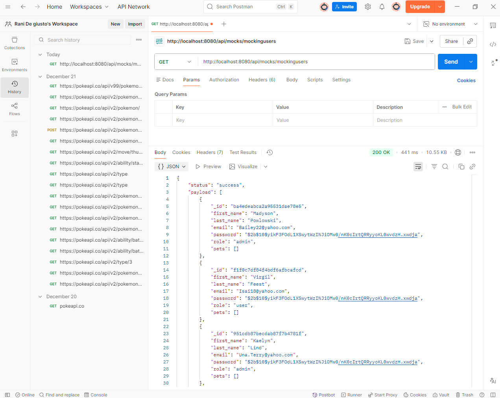
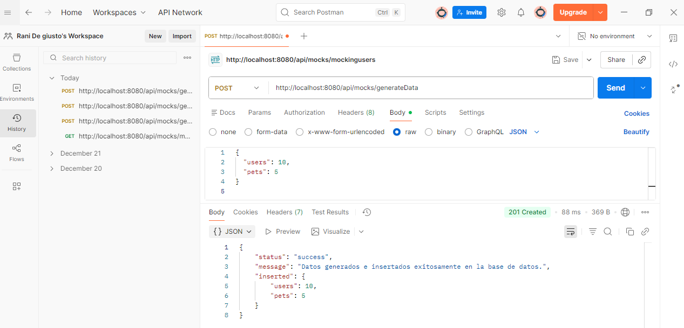

# Entrega N°1 - Programación Backend III

Proyecto **Adoptme** con módulo de Mocking y persistencia de datos ficticios.

## Requerimientos Implementados
- **Router base:** `/api/mocks`
- **GET `/api/mocks/mockingpets`:** Migración exitosa del endpoint de simulación de mascotas.
- **GET `/api/mocks/mockingusers`:** Generación en tiempo real de 50 usuarios con contraseñas encriptadas (`coder123`), roles variables (`user`/`admin`) y arreglos de mascotas vacíos.
- **POST `/api/mocks/generateData`:** Endpoint que recibe parámetros numéricos de usuarios y mascotas, genera la data con Faker.js e impacta directamente la base de datos de MongoDB.

## Pasos para ejecutar el proyecto
1. Clonar el repositorio.
2. Instalar las dependencias con `npm install`.
3. Configurar el archivo `.env` en la raíz con las variables `PORT` y `MONGO_URL`.
4. Iniciar el servidor mediante el comando `npm start`.

## Evidencia de Funcionamiento (Pruebas en Postman)
### 1. Test GET /mockingusers

### 2. Test POST /generateData
